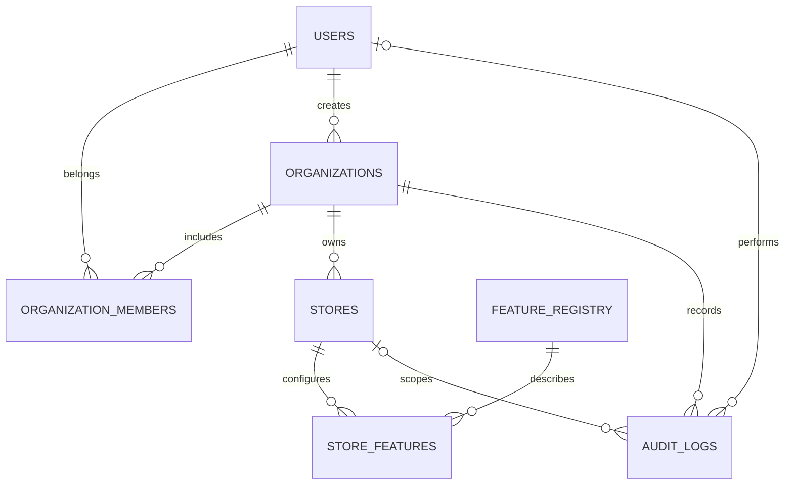

# E-Commerce Growth Engine

## Product boundary and current phase

The Growth Engine is a standalone, platform-independent merchant workspace. It owns its own PostgreSQL data and does not take ownership of any connected store's database. The connector contract is designed for Shopify, WooCommerce, Lovable applications, React/Vite, custom JavaScript, HTML storefronts, and custom backends.

Phase 1 implements authentication, organization and store records, a complete feature registry, per-store feature configuration, and audit activity. A store record is not a verified integration. No storefront SDK, platform connector, commerce synchronization, customer tracking, automation execution, analytics, marketing delivery, or AI feature is represented as operational yet.

## System architecture

```text
Merchant browser
  ├── React + TypeScript + Vite dashboard
  ├── Clerk session (cookie)
  └── generated React Query client
          │ same-origin /api requests
          ▼
Express API ── Clerk middleware ── tenant authorization
      │
      ├── feature registry and module metadata
      ├── audit records
      └── PostgreSQL via Drizzle

Future: JS SDK / React SDK → public event intake → validated event pipeline
Future: platform adapters → trusted sync and signed webhooks
Future: workers → automation, notifications, reports, and AI jobs
```

The first implementation is a modular monolith. Split services only when measured requirements justify it.

## Repository map

- `artifacts/growth-engine`: merchant dashboard.
- `artifacts/api-server`: versioned REST API and Clerk server middleware.
- `lib/api-spec/openapi.yaml`: API contract source of truth.
- `lib/api-client-react`: generated dashboard hooks.
- `lib/api-zod`: generated request/response validation.
- `lib/db/src/schema`: Drizzle-owned relational schema.
- `lib/db/migrations`: generated, version-controlled SQL migrations.
- `artifacts/api-server/src/lib/feature-catalog.ts`: canonical 45-entry registry seed.
- `docs/feature-tracker.md`: implementation status by module.

## Data model and ownership



Tenant-owned data is scoped by `organization_id`; store-specific data also has `store_id`. Unique constraints prevent duplicate organization memberships, domains within an organization, defaults within an organization, and feature settings per store. Audit history is retained until the owning organization is deleted. Store records are not deleted by a “disconnect” action; connector lifecycle work will define retention and deletion behavior before it is added.

Schema changes are generated into `lib/db/migrations`. For local development, `pnpm --filter @workspace/db run push` applies the current schema to the development database. Publishing manages the Replit production schema flow; do not manually modify production tables.

## Feature registry and dependencies

Every registry item includes a stable ID, name, description, category, version, implementation status, activation eligibility, dependencies, target platform list, permissions, required data, supported events, API paths, storefront requirements, usage limits, configuration schema, and testing requirements. The “target platforms” field records intended compatibility, not verified operation; a real connector must check its capabilities before a module can act on a store.

Shared dependencies:

- Tenant identity, membership, authorization, store records, registry/configuration, and audit logging are the foundation for all modules.
- Behaviour tracking feeds segmentation, analytics, recommendations, and approved automation triggers.
- Automation consumes validated events and invokes actions only through authorized module services.
- Notifications centralize templates, preferences, suppression, retries, and delivery records for email, push, recovery, retention, and campaigns.
- Commerce modules depend on platform capability checks; unsupported operations must remain unavailable or use a clearly documented alternative.
- AI modules may use only tenant-authorized data and must separate observations from predictions.

The exact per-feature metadata is seeded in `feature-catalog.ts`. All 45 rows are visible in the dashboard; only features explicitly marked available and activatable can be configured.

## Platform and connector strategy

| Target | Phase 1 | Planned connector path |
|---|---|---|
| React / Vite | Store platform can be recorded; no live connector | React hooks/components plus the JavaScript SDK |
| Custom JavaScript | Store platform can be recorded; no live connector | Lightweight JS SDK with consent-aware event intake |
| HTML/CSS/JavaScript | Store platform can be recorded; no live connector | Script-tag installation and storefront widgets |
| Lovable-built app | Store platform can be recorded; no existing store was supplied | Inspect its actual API first; use SDK events and server-verified sync |
| Custom backend | Store platform can be recorded; no live connector | Versioned REST API and signed webhooks |
| Shopify | Store platform can be recorded; no connector installed | Dedicated adapter and scoped app permissions |
| WooCommerce | Store platform can be recorded; no connector installed | Dedicated adapter/plugin and signed webhook validation |

The common adapter contract must expose capabilities, not platform-specific assumptions. A future JavaScript SDK must use a public store identifier, allow-listed event types, origin controls, consent context, idempotency, bounded retries, and no privileged commerce writes. Trusted commerce synchronization must come from authenticated server integrations or signature-verified webhooks. The SDK and React SDK are not shipped in Phase 1; do not distribute a placeholder installation snippet as working code.

## API contract

`lib/api-spec/openapi.yaml` defines the `/api` contract. Current operations cover:

- `GET /healthz`
- `GET/POST /organizations`, `PATCH /organizations/{organizationId}`
- `GET/POST /organizations/{organizationId}/stores`
- `GET/PATCH /stores/{storeId}`
- `GET /features`
- `GET /stores/{storeId}/features`
- `PUT /stores/{storeId}/features/{featureId}`
- `GET /dashboard/summary`
- `GET /organizations/{organizationId}/activity`

Every operation except health requires a Clerk session. Generated Zod schemas validate inputs and outputs. Keep API and frontend types generated from the contract; rerun `pnpm --filter @workspace/api-spec run codegen` after contract changes.

## Event catalogue and workflow boundary

Future event families include `visitor.created`, `session.started`, `product.viewed`, `product.searched`, `product.added_to_cart`, `cart.updated`, `cart.abandoned`, `checkout.started`, `order.created`, `order.paid`, `order.fulfilled`, `customer.created`, `customer.updated`, `customer.segment_changed`, `wishlist.item_added`, `review.submitted`, `inventory.changed`, `campaign.sent`, `notification.delivered`, and `notification.failed`.

Each event will carry a unique ID, organization/store IDs, type, time, source, entity IDs, validated properties, consent context, and processing status. Idempotency, retries, processing logs, and dead-letter handling are required before event-triggered features are enabled. Phase 1 records administrative audit activity only; it does not ingest storefront events or execute workflows. Visual automation and workflow execution remain planned.

## Security and privacy

- Clerk provides sign-up, sign-in, and verified session identity; application organizations and roles remain in the Growth Engine database.
- The API resolves the Clerk user to a local user record, checks organization membership on every tenant-scoped request, and requires owner/admin for writes.
- Store queries first resolve the store's owning organization, then verify membership. Unmatched resources return not found to avoid leaking tenant data.
- Browser API calls use same-origin Clerk session cookies. There is no client-side authorization or privileged storefront token.
- Integration secrets stay server-side in managed secrets. Future public SDK identifiers are not secrets and cannot authorize privileged writes.
- Event and webhook input must be validated, rate-limited, deduplicated, and signature-checked where applicable.
- Consent, unsubscribe/suppression, data export/deletion, retention limits, and sensitive-field masking are requirements before tracking, marketing, or recordings ship.
- Analytics must use real synchronized data or be labeled as an estimate. Scarcity and social proof must never be fabricated.

## Merchant onboarding

1. Create an account using the public landing page's sign-up flow.
2. Create an organization; the creator becomes its owner.
3. Add a store record and select its platform.
4. Treat its status as “setup required” until a platform-specific connector verifies it.
5. Review the feature registry and only configure available modules.
6. Later connector onboarding will provide platform permissions, SDK installation, verification, and synchronization status.

## Roadmap and acceptance

1. **Foundation (current):** auth, tenants, stores, complete registry, per-store settings, audit trail, initial dashboard.
2. **First connector:** inspect the user's actual store, then implement its adapter, SDK installation, verification, trusted sync, and connection health.
3. **Shared intelligence:** consent-aware event intake, segmentation, real automation execution, notification delivery, and workflow logs.
4. **Sales/shopping modules:** modules 7–22.
5. **Marketing/conversion modules:** modules 23–34.
6. **Analytics:** modules 35–39, validated against source data.
7. **Retention:** modules 40–43.
8. **AI:** modules 44–45, grounded in authorized data.
9. **Platform expansion and production readiness:** add Shopify/WooCommerce/custom adapters, billing, monitoring, backup/recovery, security review, and end-to-end acceptance.

Phase 1 is accepted when a user can sign in, create an organization, add and edit stores, view all 45 registry entries, persist per-store settings for activatable features, and cannot read or change another organization's records. Store records created in this phase remain explicitly unverified.

## Verification and operations

- Type check: `pnpm run typecheck`
- Generate API clients: `pnpm --filter @workspace/api-spec run codegen`
- Generate a DB migration: `pnpm --filter @workspace/db run generate`
- Apply schema to development: `pnpm --filter @workspace/db run push`
- API workflow: `artifacts/api-server: API Server`
- Dashboard workflow: `artifacts/growth-engine: web`

The current automated check is TypeScript typechecking. The 45 modules are not complete merely because they appear in the registry; each needs module-specific unit, integration, authorization, connector, UI, and data-correctness tests before its status can advance.
